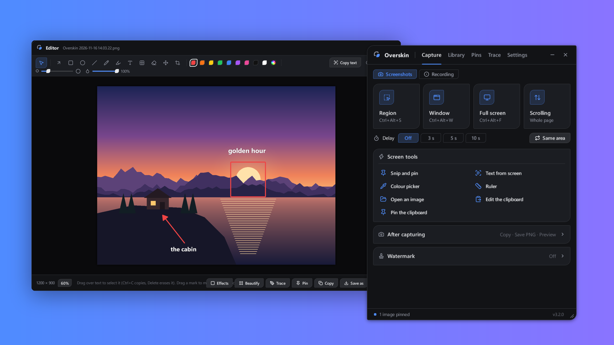
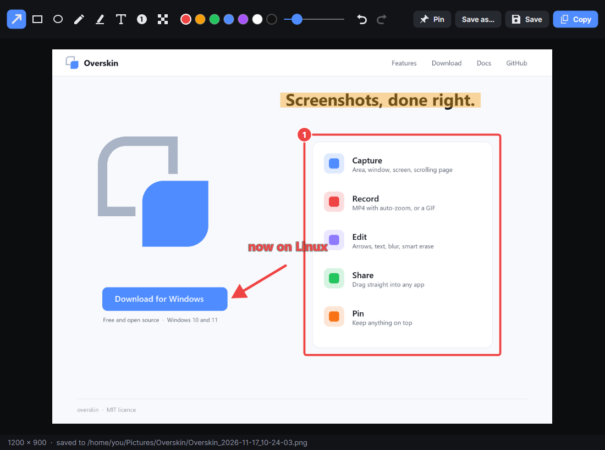
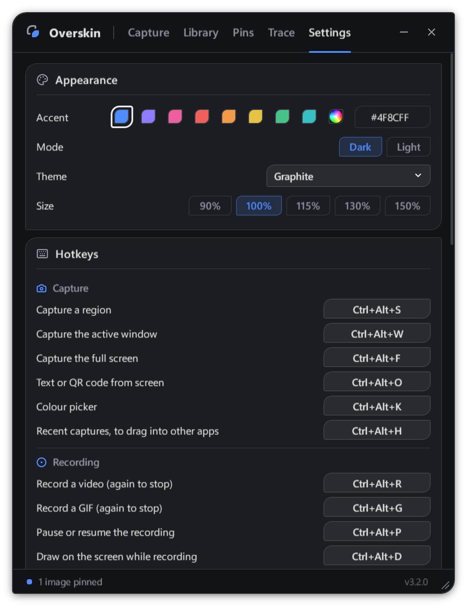
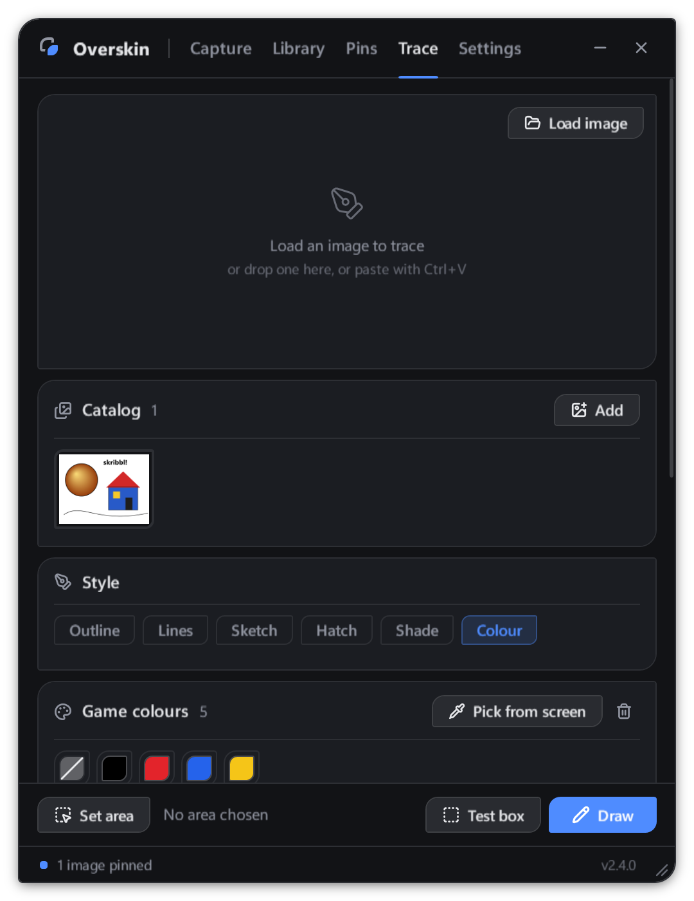
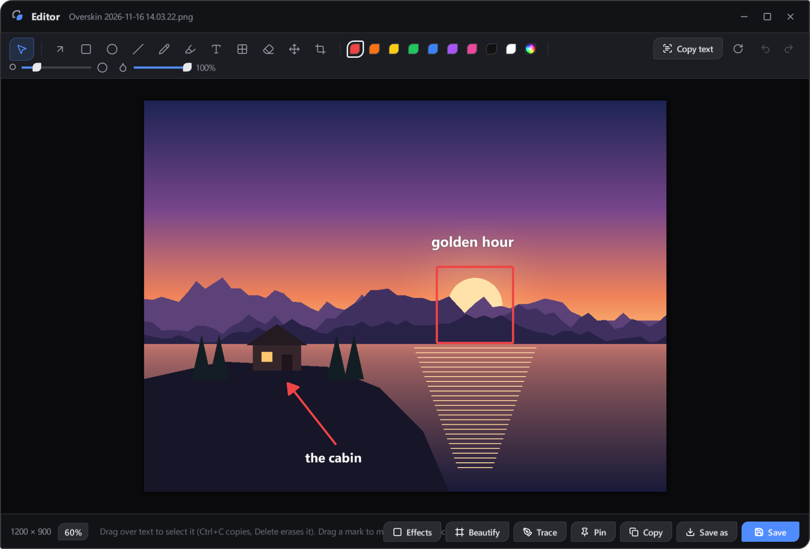

<p align="center"></p>

# Overskin

**Screenshots, done right.**

<p align="center"></p>

A free, open-source screenshot and screen-recording tool for Windows. Capture any area,
window or scrolling page; record MP4 videos with smooth auto-zoom or GIFs; mark it up, hide
private details, beautify it and drag it straight into any app. Plus the extras artists and
tinkerers want: pin anything on top of your screen, trace over it, or let Overskin draw it for
you in skribbl.io and Gartic Phone.

One installer, no administrator rights, no account, and nothing leaves your PC.

## Download

Download **`OverskinSetup.exe`** from the [latest release](../../releases/latest) and run it.
It installs for your user only (no administrator rights) into
`%LocalAppData%\Programs\Overskin`, with optional Start menu and desktop shortcuts and start
with Windows. Remove it from Settings → Apps like any other app. Running a newer setup
updates it in place and keeps your settings.

It needs Windows 10 1809 or later (64-bit). Windows SmartScreen may warn about an unsigned
app the first time: choose **More info → Run anyway**.

### Linux (preview)

Download **`overskin-linux-x64.tar.gz`** from the [latest release](../../releases/latest), then:

```bash
tar -xzf overskin-linux-x64.tar.gz && ./overskin/install.sh
```

That puts `overskin` in `~/.local/bin` and adds it to your app menu, for your user only (no
sudo). Add `--autostart` to start it with your desktop in the tray, or `--uninstall` to remove
it. It's one self-contained program and works on X11 and Wayland (GNOME, KDE, Sway, Hyprland
and others).

The Linux version is new and has nearly everything: area, window, screen and scrolling
capture, with drawing on the screen first and a magnifier; the editor (arrows, lines, boxes,
circles, pen, highlighter, text, numbered steps, blur / pixelate / mosaic, smart erase, crop,
turn, flip, resize, beautify, auto-hide, copying text, full undo); MP4 and GIF recording with
auto-zoom; the GIF editor; the step recorder; the Library (search, sort, select several,
rename, convert, combine, drag out, trash); recent captures; pins, including see-through and
click-through for tracing; Trace, which draws a picture with the mouse; themes; and the tray
menu. What Wayland itself doesn't allow is noted where it matters: on GNOME and KDE under
Wayland, window picking, scrolling by itself, seeing clicks and moving the mouse aren't open to
apps (Hyprland and Sway allow more, and ydotool can move the mouse).

Optional helpers it uses when they're installed: `ffmpeg` (recording on X11, GIFs,
converting), `wf-recorder` (recording on Hyprland and Sway), GStreamer with its PipeWire
plugin (recording on GNOME and KDE under Wayland), and `tesseract` (auto-hide, copying text,
searching the text in pictures), and `ydotool` (moving the mouse on Wayland, for scrolling capture
and Trace). Overskin says which one is missing when you need it.

Desktops keep global shortcuts to themselves on Linux, so bind a key in your keyboard settings
to `overskin --capture` (or `--screen`, `--delay 3`, `--record`, `--gif`, `--stop`).
`--scroll`, `--steps`, `--step` and `--recent` work the same way; `overskin --help` lists
everything.
On Wayland the first capture may ask you to allow screenshots. On Hyprland, Sway and other
wlroots desktops, install `grim`, which Overskin uses to read the screen there. For copying to the
clipboard, install `wl-clipboard` (Wayland) or `xclip` (X11) if you don't have them already.
If something goes wrong, **Copy details for a bug report** at the bottom of the window copies
what Overskin logged (`~/.cache/overskin/overskin.log`).

<p align="center"></p>

## Screenshots

| | |
| --- | --- |
|  |  |
| **Capture**: area, window, screen or a whole scrolling page | **Recording**: MP4 with auto-zoom and a sharp pointer, or GIF |
|  |  |
| **Library**: search the text in your captures, convert, rename | **Settings**: dark or light, editor themes, any accent |
|  |  |
| **Trace**: draw a picture in a drawing game, colour by colour | **Light** theme |


**Editor**: arrows, boxes, text, steps, highlighter, hide (blur, pixelate, mosaic, or Auto-hide
for private details), smart erase, crop, rotate, and Beautify.


**Capture bar**: what to capture, marks to draw first, pointer and magnifier.

## Capture

- **Region**: drag over an area, or just click a window. The screen freezes while you
  choose, so menus and tooltips stay put, and a magnifier shows the exact pixel under the
  cursor.
- **Capture bar** along the top while you choose: capture an area, a window, one screen or
  every screen (1 to 4); draw first with a pen, arrows, boxes or a highlighter (P, A, B, H; C
  changes colour, Ctrl+Z undoes); include the mouse pointer or not; magnifier on or off (M).
- **Shape**: keep the area to 16:9, 4:3, 1:1 or 9:16, or an exact size such as 1920 × 1080
  that follows the mouse (from the capture bar).
- **Window** and **full screen** (the monitor the mouse is on), plus **Same area** to repeat
  the last region. With *Windows on a transparent background*, a clicked window comes out on
  its own, with no desktop behind it and a soft shadow.
- **Scrolling**: pick the part of a window that scrolls. Overskin scrolls it with the mouse
  wheel and joins every new strip into one tall picture, stopping at the end of the page
  (or when you press Esc). Fixed headers and footers appear once.
- **Delay timer**: 3, 5 or 10 seconds.
- **After capturing**, any mix of copy to the clipboard, save to a folder (PNG or JPG),
  open in the editor, pin it where it was, and a preview card with Edit, Pin, Copy, Trace
  and Show in folder. Optionally with the mouse pointer drawn in.

## Video

Capture → **Recording** has the Video and GIF buttons and every video setting.

- **Record** any area, a window or the whole screen as an MP4 (30 or 60 fps, H.264, using
  Windows' own encoder, with no length limit). Click Video again or press Esc to stop.
- **Pointer**: drawn from vector shapes (white or black), so it stays perfectly sharp at any
  size and any zoom, or your own Windows pointer read at full resolution from its file. Size,
  smoothing (calms shaky movement) and a ring on each click are all adjustable.
- **Auto-zoom**: the video glides in towards each click, follows the pointer while you work
  and eases back out after a few quiet seconds. Zoom amount, zoom speed, how loosely the view
  follows, and how long it waits before zooming out are all adjustable.
- Videos go in the Library; click one to play it.
- **Steps**: click through anything and get a numbered how-to picture: one screenshot per
  click, the click circled, and a sentence such as *Click the "Save" button in Notepad*.

## GIF clips

- **Record** any area as a GIF (15 fps, up to 30 seconds) with Ctrl+Alt+G or the GIF tile.
  A red frame marks the area and a small bar shows the time with Stop and Cancel; neither
  appears in the recording. Press Ctrl+Alt+G again, or Esc, to stop.
- **GIF editor**: Discord-style captions (black text on a white bar above the clip) or
  classic top-and-bottom Impact text, trim, speed (0.5× to 2×), normal / reverse / boomerang
  looping, and output width.
- **Copy** puts the GIF on the clipboard as a file, so Ctrl+V in Discord just works. Or save
  it.
- **Caption a GIF** opens any existing GIF (or a still picture) in the same editor.

## Edit

Arrows, boxes, ellipses, lines, pen, highlighter, text, numbered steps, hide and crop. Nine
colours, adjustable size, undo and redo, and keyboard shortcuts for every tool (A, R, E, L, P,
H, T, N, B, X, C, V). Copy, save, pin or trace the result.

- **Hide** (B): blur, pixelate or mosaic, with the size slider setting how coarse it is.
  **Auto-hide** reads the picture and hides every email, phone number, card number, IP
  address and key it finds. Turn on *Hide private details automatically* (Capture page) to
  do that to every screenshot before it's copied or saved.
- **Smart erase** (X): paint over text, an icon or a person and it's filled in from what's
  around it. Best on plain or gently shaded backgrounds, which is most of a screenshot.
- **Beautify**: puts the picture on a gradient or plain backdrop with padding, rounded
  corners and a shadow, optionally 16:9, 4:3, 1:1 or 9:16, ready to post.

## Library

Every saved capture with a thumbnail, filtered by pictures, GIFs or videos. Click to edit;
right-click to copy, pin, trace, show in the folder, or move to the Recycle Bin.

**Convert to** (right-click a capture) makes a copy in another format next to the original:
PNG, JPG, BMP or TIFF; a GIF; or an MP4 video. A picture becomes a 5-second video or a
one-frame GIF, a GIF keeps its timing as a video, and a video becomes an animated GIF (15 fps,
the first 30 seconds).

**Search** finds captures by the words inside them: each capture's text is read once in the
background with Windows' built-in text reader (offline) and kept in
`%LocalAppData%\Overskin\search-index.json`.

**Recent captures** (Ctrl+Alt+H) shows the latest ten in a strip along the bottom of the
screen: drag one straight into Discord, a browser or a folder, or click to open it. The
after-capture card can be dragged out the same way.

**Combine** puts a few pictures together for tutorials: pick them in the order you want,
then choose side by side, stacked, or a grid collage. The result opens in the editor for
arrows and text. The tray menu can also combine picture files.

## Screen tools

- **Snip and pin**: keep part of the screen floating on top.
- **Text from screen**: drag over any text (in a video, a picture, a game) and it's copied.
  Uses the OCR built into Windows, so it works offline.
- **Colour picker**: copy the hex code of any pixel.
- **Ruler**: measure distances, sizes and angles in pixels.
- **Open an image** or **edit the clipboard** in the editor.

## Pins

**Pictures**: pin any image above everything else; resize, fade, rotate, flip, grayscale,
lock, and add a **drawing grid** (3×3 to 8×8) for copying by hand. Make it click-through and
it becomes tracing paper over your drawing program; hold Ctrl+Alt to grab it again. Pinned
pictures come back where you left them next time.

**Windows**: pin any window on top, fade it, or make it click-through. Every window is put
back exactly as it was when you unpin it or quit.

## Trace

Turns a picture into pen strokes and draws it with your real mouse: in Paint, Krita, or a
browser game like skribbl.io or Gartic Phone. Six styles: *Outline*, *Lines* (one stroke per
line), *Sketch* (for photos), *Hatch*, *Shade*, and *Colour* (paints with the game's own
palette). Every picture you trace is kept in a catalog for next time. Speed presets:
*Optimized* (one point per refresh of your monitor, the fastest a browser game can follow),
*Careful*, *Fast* and *Instant*. Pause and resume, a start hotkey that works from inside the
game, and it stops the moment you touch the mouse.

**Fill with bucket** (Outline and Colour styles) uses the game's own paint bucket: it outlines
each big area, then fills it with one click instead of hatching it line by line. Areas no
wider than the brush are drawn as a single stroke down the middle, and anti-aliased slivers
are cleaned up first. Pick the game's brush and bucket buttons once, and set *Brush size* to
the brush you draw with. On a typical cartoon it draws about three times faster.

## Shortcuts

| Keys | Action |
| --- | --- |
| Ctrl+Alt+S | Capture a region |
| Ctrl+Alt+W | Capture the active window |
| Ctrl+Alt+F | Capture the full screen |
| Ctrl+Alt+A | Snip and pin |
| Ctrl+Alt+O | Text from screen |
| Ctrl+Alt+K | Colour picker |
| Ctrl+Alt+G | Record a GIF (again to stop) |
| Ctrl+Alt+T | Pin / unpin the window under the mouse |
| Ctrl+Alt+Up / Down | Opacity of the window or picture under the mouse |
| Ctrl+Alt+C | Toggle click-through |
| Hold Ctrl+Alt | Grab a click-through picture while held |
| Ctrl+Alt+D | Start drawing (Trace) |
| Ctrl+Alt+P | Pause / resume drawing |
| Esc or Ctrl+Alt+X | Stop drawing |

All of them can be changed in Settings, including to a bare Print Screen. The defaults avoid
Ctrl+Alt combinations that type characters on European keyboards (AltGr+Q, E, M and digits).

## Right-click menus

Right-click the tray icon for every feature, grouped into Capture, Tools, Pin, Edit and Open.
Right-click Overskin on the taskbar or in Start for the main captures and recordings.

## Settings

**Mode and theme**: Dark or Light, then a theme: Overskin's own (Graphite, Carbon, Ink,
Black; Light, Paper) or a well-known editor palette (Visual Studio, Dracula, Nord, Gruvbox,
Monokai, One Dark, Tokyo Night, Catppuccin, Solarized, GitHub, Serika). Editor themes bring
their own accent colour, which you can still change.
Accent colour (presets, colour wheel or hex), interface size from 90% to
150%, a resizable window, start with Windows, and close to the tray.

## Build

Requires the .NET SDK 8 or newer, on Windows 10 1809 or later.

```
./build.ps1
```

That writes `dist/OverskinSetup.exe`, the installer with the app inside it (the app on its own
is built into `build/app` on the way). Open `Overskin.sln` to work on either in Visual Studio or
Rider.

For Linux, `./build-linux.sh` (on Linux, with the .NET 8 SDK) writes
`dist/overskin-linux-x64.tar.gz`. `overskin --selftest` checks it, and `dotnet run --project
src/Overskin.Linux -- --demo picture.png` runs it on any system with a picture standing in for
the screen.

`OverskinSetup.exe` also takes `--quiet` with `--dir PATH`, `--no-startmenu`, `--desktop`,
`--startup` / `--no-startup` and `--launch`. `Uninstall.exe --uninstall --quiet` removes it
again (add `--remove-settings` to delete its settings too).

Settings are saved in `%AppData%\Overskin\overskin.settings.json` (settings left next to the
exe by older versions are moved there automatically). The search index, crash reports and
pinned-picture cache are in `%LocalAppData%\Overskin`. Captures go to `Pictures\Overskin`
unless you choose another folder.

## Project layout

| Folder | What's in it |
| --- | --- |
| `src/Overskin/Main/` | The app window and its tabs: capture, library, pins, trace, settings |
| `src/Overskin/Capture/` | The frozen-screen chooser, preview card, screen grabs, text from screen, scroll stitching |
| `src/Overskin/Editor/` | The screenshot editor and its marks |
| `src/Overskin/Gif/` | GIF recording, encoding and decoding, captions, the GIF editor |
| `src/Overskin/Video/` | MP4 recording, the auto-zoom camera |
| `src/Overskin/Pins/` | Pinned pictures, and pinning, fading and click-through for windows |
| `src/Overskin/Trace/` | Tracing, drawing with the mouse, game palettes, the drawing area |
| `src/Overskin/Interface/` | Colours, the colour wheel, the icon control |
| `src/Overskin/Core/` | Win32 calls, settings, hotkeys, tray, messages, crash reports |
| `src/Overskin/Themes/` | Control styles, palette and icons |
| `src/Overskin/Assets/` | App icon and logo |
| `src/Installer/` | `OverskinSetup.exe`: the per-user installer and uninstaller |
| `src/Overskin.Linux/` | The Linux version (Avalonia): capture, editor, pins, tray |
| `packaging/linux/` | The Linux install script and menu entry |
| `docs/screenshots/` | The pictures in this README |

## Known limitations

- Windows running as administrator can't be pinned, faded or drawn into unless Overskin also
  runs as administrator. (Capturing them works.)
- Monitors with different scaling: captures are pixel-exact, but the selection overlay is
  drawn at one scale across all screens.
- Text from screen needs a Windows OCR language; most installs include one.
- Window captures copy what's on screen, so anything overlapping the window is included.
- WebP needs the Windows "WebP Image Extensions" codec. Animated GIFs show the first frame.
- If Overskin is force-closed, windows it changed stay changed until those programs restart.

## Privacy

Overskin has no telemetry and never checks in with anything. It makes no network connections. If it
crashes, a short report is saved to `%LocalAppData%\Overskin\logs` with the error and the
Windows version only. Nothing is sent.

## Bugs and ideas

Open an issue. For a crash, attach the newest file from Settings → About → Crash reports.

## Credits

- Icons by [Lucide](https://lucide.dev), ISC License.

Full texts are in `THIRD-PARTY-NOTICES.md`.

## License

[MIT](LICENSE).
