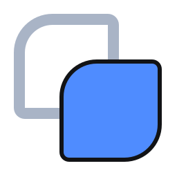
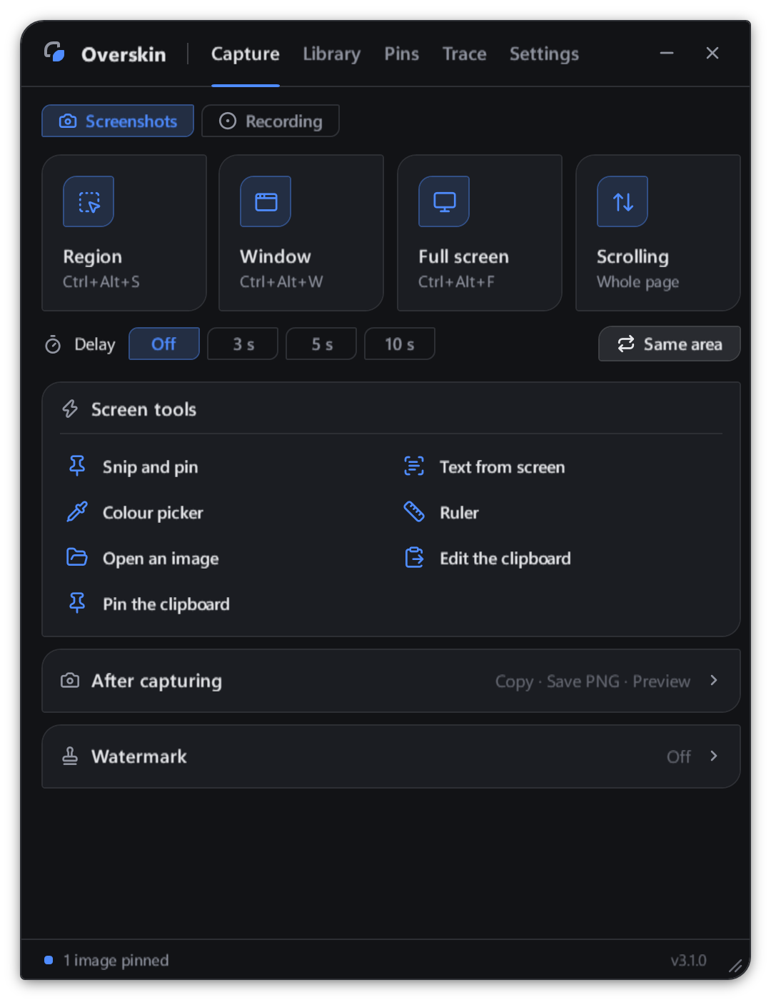
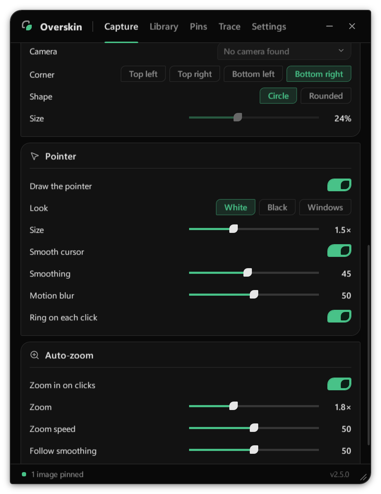
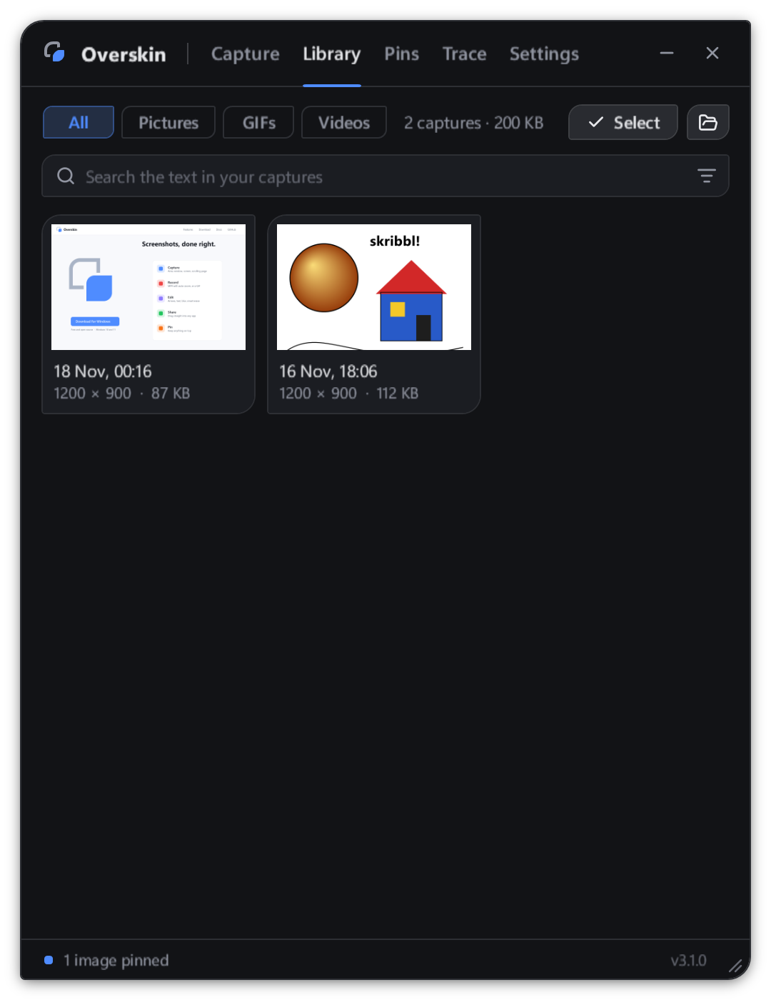
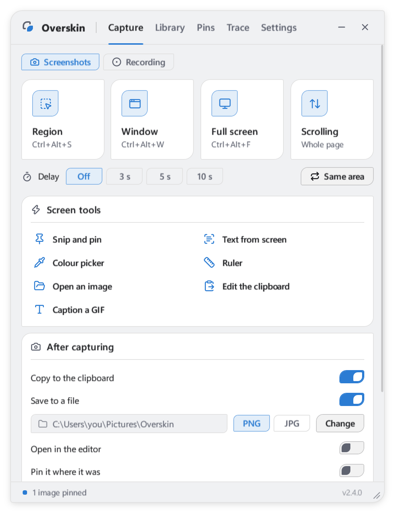
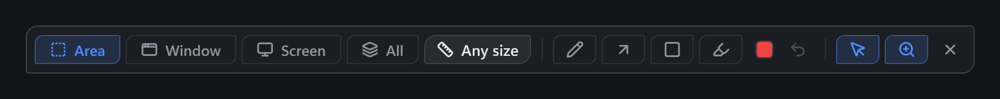

<div align="center">



# Overskin

**Screenshots, done right.**

A free, open-source screenshot and screen-recording tool for Windows.

[](https://github.com/overskin/Overskin/releases/latest/download/OverskinSetup.exe)

[](../../releases/latest)
[](../../releases)
[](#download)
[](LICENSE)
[](#privacy)

[Download](#download) · [Capture](#capture) · [Video](#video) · [Edit](#edit) · [Pins](#pins) · [Trace](#trace) · [Shortcuts](#shortcuts) · [Changelog](CHANGELOG.md)


</div>

Capture any area, window or scrolling page; record MP4 videos with auto-zoom and a smooth,
motion-blurred cursor, or GIFs; mark it up, fix a typo in the screenshot itself, hide private
details, beautify it and drag it straight into any app. Plus the
extras artists and tinkerers want: pin anything on top of your screen, trace over it, or let
Overskin draw it for you in skribbl.io and Gartic Phone.

One installer, no administrator rights, no account, and nothing leaves your PC.

## Highlights

| | |
| --- | --- |
| **Auto-zoom videos** | MP4 recordings glide in on every click and follow the pointer, with sound, your webcam in a corner, and an optional backdrop. |
| **Smooth cursor** | The pointer in your videos glides with no lag, lands exactly on each click and gets motion blur, like a professionally edited demo. |
| **Edit text in screenshots** | Select, delete or type words inside any screenshot. New letters come out in the picture's own font, size and colour. |
| **Live text** | Copy the words in any screenshot, and search your whole library by them. Offline. |
| **Auto-hide** | Finds and blurs emails, card numbers, addresses, IPs and keys before you share. |
| **Smart erase** | Paint over text or an icon and it's filled in from what's around it. |
| **Steps** | Click through a task and get a numbered how-to guide as a picture, web page, Markdown or PDF. |
| **Scrolling capture** | Scrolls the window for you and stitches the whole page together. |
| **Pins and tracing paper** | Float any picture or window on top, fade it, make it click-through. |
| **Workflows** | One hotkey for a whole routine: capture, hide private details, watermark, copy. |
| **Trace** | Turns a picture into mouse strokes and draws it in Paint, Krita, skribbl.io or Gartic Phone. |

## Download

Download **`OverskinSetup.exe`** from the [latest release](../../releases/latest) and run it.
It installs for your user only (no administrator rights) into
`%LocalAppData%\Programs\Overskin`, with optional Start menu and desktop shortcuts and start
with Windows. Remove it from Settings → Apps like any other app. Running a newer setup
updates it in place and keeps your settings.

It needs Windows 10 1809 or later (64-bit). Windows SmartScreen may warn about an unsigned
app the first time: choose **More info → Run anyway**.

### Platforms

Overskin runs on **Windows** today. **Linux** and **macOS** versions are planned for the future.

## Screenshots

| | |
| --- | --- |
|  |  |
| **Capture**: area, window, screen or a whole scrolling page | **Recording**: MP4 with auto-zoom, a smooth cursor and motion blur, or GIF |
|  |  |
| **Library**: search the text in your captures, convert, rename | **Settings**: dark or light, editor themes, any accent |
|  |  |
| **Trace**: draw a picture in a drawing game, colour by colour | **Light** theme |


**Editor**: arrows, boxes, text, steps, highlighter, hide (blur, pixelate, mosaic, or Auto-hide
for private details), smart erase, crop, rotate, and Beautify.


**Capture bar**: what to capture, marks to draw first, pointer and magnifier.

## Capture

- **Region**: drag over an area, or just click a window. The screen freezes while you
  choose, so menus and tooltips stay put, and a magnifier shows the exact pixel under the
  cursor.
- **Capture bar** along the top while you choose: capture an area, a window, one screen or
  every screen (1 to 4); draw first with a pen, arrows, boxes or a highlighter (P, A, B, H; C
  changes colour, Ctrl+Z undoes); include the mouse pointer or not; magnifier on or off (M).
- **Shape**: keep the area to 16:9, 4:3, 1:1 or 9:16, or an exact size such as 1920 × 1080
  that follows the mouse (from the capture bar).
- **Window** and **full screen** (the monitor the mouse is on), plus **Same area** to repeat
  the last region. With *Windows on a transparent background*, a clicked window comes out on
  its own, with no desktop behind it and a soft shadow.
- **Scrolling**: pick the part of a window that scrolls. Overskin scrolls it with the mouse
  wheel and joins every new strip into one tall picture, stopping at the end of the page
  (or when you press Esc). Fixed headers and footers appear once.
- **Delay timer**: 3, 5 or 10 seconds.
- **After capturing**, any mix of copy to the clipboard, save to a folder (PNG or JPG),
  open in the editor, pin it where it was, and a preview card with Edit, Pin, Copy, Trace
  and Show in folder. Optionally with the mouse pointer drawn in.
- **Watermark**: your name, handle or logo on every screenshot and video, in a corner, the
  middle or tiled across. Text or a picture, with size and opacity.
- **Workflows** (Settings): give a whole routine its own hotkey. Capture an area, the window in
  front, the screen or the same area again, wait first if you like, then any of: hide private
  details, beautify, watermark, save, copy the picture or its text, pin, open in the editor.
  Workflows are in the tray menu too.

## Video

Capture → **Recording** has the Video and GIF buttons and every video setting.

- **Record** any area, a window or the whole screen as an MP4 (30 or 60 fps, H.264, using
  Windows' own encoder, with no length limit). Click Video again or press Esc to stop. The
  screen is read straight from the graphics card, about three times faster than before.
- **Sound**: what your speakers play, your microphone (pick which one), or both.
- **Webcam**: you in a circle or rounded square in any corner, sized to suit.
- **Pointer**: drawn from vector shapes (white or black), so it stays perfectly sharp at any
  size and any zoom, or your own Windows pointer read at full resolution from its file. Size,
  smoothing and a ring on each click are all adjustable.
- **Smooth cursor** (on by default): the pointer is recorded apart from the picture and drawn
  a fraction of a second later, so it can be smoothed with no lag: it glides, eases in and out,
  lands exactly on each click and gets motion blur while it moves (*Motion blur* sets how much).
- **Backdrop**: put the recording on a gradient with rounded corners and a shadow.
- **Keyboard shortcuts**: show shortcuts like Ctrl + C in the video. Ordinary typing is never shown.
- **Auto-zoom**: the video glides in towards each click, follows the pointer while you work
  and eases back out after a few quiet seconds. Zoom amount, zoom speed, how loosely the view
  follows, and how long it waits before zooming out are all adjustable.
- **Trim**: click a video in the Library to play it, drag Start and End (or press I and O),
  and save the part in between as a new file. Sound is kept.
- **Steps**: click through anything and get a numbered how-to guide: one screenshot per
  click, the click circled, and a sentence such as *Click the "Save" button in Notepad*.
  Reword or drop steps, then save it as one picture, an HTML page, Markdown or a PDF.

## GIF clips

- **Record** any area as a GIF (15 fps, up to 30 seconds) with Ctrl+Alt+G or the GIF tile.
  A red frame marks the area and a small bar shows the time with Stop and Cancel; neither
  appears in the recording. Press Ctrl+Alt+G again, or Esc, to stop.
- **GIF editor**: Discord-style captions (black text on a white bar above the clip) or
  classic top-and-bottom Impact text, trim, speed (0.5× to 2×), normal / reverse / boomerang
  looping, and output width.
- **Copy** puts the GIF on the clipboard as a file, so Ctrl+V in Discord just works. Or save
  it.
- **Caption a GIF** opens any existing GIF (or a still picture) in the same editor.

## Edit

Arrows, boxes, ellipses, lines, pen, highlighter, text, numbered steps, hide and crop. Nine
colours plus a colour wheel, adjustable size and opacity, undo and redo, and keyboard shortcuts
for every tool (A, R, E, L, P, H, T, N, B, X, C, V). Copy, save, pin or trace the result.

- **Live text**: with the Select tool (V), drag over the text in a screenshot to select it
  letter by letter, like in a PDF; a double-click takes a whole word. Click inside a word for a
  text cursor: Backspace and Delete remove letters and the rest of the line closes up, the arrow
  keys move it (Shift selects). Letters are found from the ink in the picture, so it works in
  any font. **Type** at the cursor and the new letters come out in the line's own font, size and
  colour, worked out from the picture (Segoe UI, Arial, Calibri, Cambria, Georgia, Times New
  Roman, Verdana, Tahoma, Trebuchet MS, Consolas, Courier New, regular or bold), with the rest of
  the line moving along. Typing needs text on a plain background. Ctrl+C copies the selection, and right-click can erase it in place or hide it.
  **Copy text** (Ctrl+Shift+C) copies every word in the picture.

- **Hide** (B): blur, pixelate or mosaic, with the size slider setting how coarse it is.
  **Auto-hide** reads the picture and hides every email, phone number, card number (with its
  expiry date and security code), IP address, key, folder path and street address it finds;
  right-click it to choose which, including cities, states, postcodes and countries. Turn on *Hide private details automatically* (Capture page) to
  do that to every screenshot before it's copied or saved.
- **Smart erase** (X): paint over text, an icon or a person and it's filled in from what's
  around it. Best on plain or gently shaded backgrounds, which is most of a screenshot.
- **Beautify**: puts the picture on a gradient or plain backdrop with padding, rounded
  corners and a shadow, optionally 16:9, 4:3, 1:1 or 9:16, ready to post.

## Library

Every saved capture with a thumbnail, filtered by pictures, GIFs or videos. Click to edit;
right-click to copy, pin, trace, show in the folder, or move to the Recycle Bin.

**Convert to** (right-click a capture) makes a copy in another format next to the original:
PNG, JPG, BMP or TIFF; a GIF; or an MP4 video. A picture becomes a 5-second video or a
one-frame GIF, a GIF keeps its timing as a video, and a video becomes an animated GIF (15 fps,
the first 30 seconds).

**Search** finds captures by the words inside them: each capture's text is read once in the
background with Windows' built-in text reader (offline) and kept in
`%LocalAppData%\Overskin\search-index.json`.

**Recent captures** (Ctrl+Alt+H) shows the latest ten in a strip along the bottom of the
screen: drag one straight into Discord, a browser or a folder, or click to open it. The
after-capture card can be dragged out the same way.

**Combine** puts a few pictures together for tutorials: pick them in the order you want,
then choose side by side, stacked, or a grid collage. The result opens in the editor for
arrows and text. The tray menu can also combine picture files.

## Screen tools

- **Snip and pin**: keep part of the screen floating on top.
- **Text from screen**: drag over any text (in a video, a picture, a game) and it's copied.
  Uses the OCR built into Windows, so it works offline.
- **Colour picker**: copy the hex code of any pixel.
- **Ruler**: measure distances, sizes and angles in pixels.
- **Open an image** or **edit the clipboard** in the editor.

## Pins

**Pictures**: pin any image above everything else; resize, fade, rotate, flip, grayscale,
lock, and add a **drawing grid** (3×3 to 8×8) for copying by hand. Make it click-through and
it becomes tracing paper over your drawing program; hold Ctrl+Alt to grab it again. Pinned
pictures come back where you left them next time.

**Free Transform**: click a pinned picture and it gets a Photoshop-style box with eight
handles. Drag inside to move, a corner to scale in proportion, a side to stretch one way, or
outside the box to rotate. Shift stretches freely from a corner (or keeps proportions on a
side), straightens a move, and rotates in 15° steps; Alt scales from the middle. Enter or a
double-click commits, Esc puts it back, Ctrl+T shows or hides the box, and the arrow keys nudge.

**Compare**: pick two pictures in the Library (or Edit → Compare two pictures in the tray menu) and they open
pinned on top, one over the other. Drag across to wipe between before and after, or switch to
Fade to see one through the other.

**Windows**: pin any window on top, fade it, or make it click-through. Every window is put
back exactly as it was when you unpin it or quit.

## Trace

Turns a picture into pen strokes and draws it with your real mouse: in Paint, Krita, or a
browser game like skribbl.io or Gartic Phone. Seven styles: *Outline*, *Lines* (one stroke per
line), *Sketch* (for photos), *Hatch*, *Shade*, *Colour* (paints with the game's own
palette) and *Gartic Phone*. Every picture you trace is kept in a catalog for next time. Speed presets:
*Optimized* (one point per refresh of your monitor, the fastest a browser game can follow),
*Careful* and *Fast*. Pause and resume, a start hotkey that works from inside the
game, and it stops the moment you touch the mouse.

**Gartic Phone** paints rather than traces, using the game's five brush sizes and its opacity
levels. Like a person, it sketches the outlines first, then colours in up to them with the
biggest brush, then each smaller brush only goes where the result is still off. Strokes are
continuous smooth curves, never dots; each one eases in and out, wobbles very slightly, and
the pen lifts between strokes. Every stroke picks a colour and an
opacity, so layering makes shades the palette doesn't have (thin red over white is pink).
Overskin simulates the canvas as it plans, and the preview shows the finished painting. The
Gartic Phone card is a four-step checklist that ticks itself off: pick the game's colours,
pick its buttons (a message says which to click: the pen, the five sizes smallest first, then
the faintest and the full opacity), set the area over the canvas, then *Measure*, which draws
a test line with each brush, reads how thick it came out and undoes them. *Detail* trades
drawing time for accuracy.

## Shortcuts

| Keys | Action |
| --- | --- |
| Ctrl+Alt+S | Capture a region |
| Ctrl+Alt+W | Capture the active window |
| Ctrl+Alt+F | Capture the full screen |
| Ctrl+Alt+A | Snip and pin |
| Ctrl+Alt+V | Pin the picture on the clipboard |
| Ctrl+Alt+O | Text from screen |
| Ctrl+Alt+K | Colour picker |
| Ctrl+Alt+G | Record a GIF (again to stop) |
| Ctrl+Alt+T | Pin / unpin the window under the mouse |
| Ctrl+Alt+Up / Down | Opacity of the window or picture under the mouse |
| Ctrl+Alt+C | Toggle click-through |
| Hold Ctrl+Alt | Grab a click-through picture while held |
| Ctrl+Alt+D | Start drawing (Trace) |
| Ctrl+Alt+P | Pause / resume drawing |
| Esc or Ctrl+Alt+X | Stop drawing |

All of them can be changed in Settings, including to a bare Print Screen. The defaults avoid
Ctrl+Alt combinations that type characters on European keyboards (AltGr+Q, E, M and digits).

## Right-click menus

Right-click the tray icon for every feature, grouped into Capture, Tools, Pin, Edit and Open.
Right-click Overskin on the taskbar or in Start for the main captures and recordings.

## Settings

**Mode and theme**: Dark or Light, then a theme: Overskin's own (Graphite, Carbon, Ink,
Black; Light, Paper) or a well-known editor palette (Visual Studio, Dracula, Nord, Gruvbox,
Monokai, One Dark, Tokyo Night, Catppuccin, Solarized, GitHub, Serika). Editor themes bring
their own accent colour, which you can still change.
Accent colour (presets, colour wheel or hex), interface size from 90% to
150%, a resizable window, start with Windows, and close to the tray.

## Build

Requires the .NET SDK 8 or newer, on Windows 10 1809 or later.

```
./build.ps1
```

That writes `dist/OverskinSetup.exe`, the installer with the app inside it (the app on its own
is built into `build/app` on the way). Open `Overskin.sln` to work on either in Visual Studio or
Rider.

`OverskinSetup.exe` also takes `--quiet` with `--dir PATH`, `--no-startmenu`, `--desktop`,
`--startup` / `--no-startup` and `--launch`. `Uninstall.exe --uninstall --quiet` removes it
again (add `--remove-settings` to delete its settings too).

Settings are saved in `%AppData%\Overskin\overskin.settings.json` (settings left next to the
exe by older versions are moved there automatically). The search index, crash reports and
pinned-picture cache are in `%LocalAppData%\Overskin`. Captures go to `Pictures\Overskin`
unless you choose another folder.

## Project layout

| Folder | What's in it |
| --- | --- |
| `src/Overskin/Main/` | The app window and its tabs: capture, library, pins, trace, settings |
| `src/Overskin/Capture/` | The frozen-screen chooser, preview card, screen grabs, text from screen, scroll stitching |
| `src/Overskin/Editor/` | The screenshot editor and its marks |
| `src/Overskin/Gif/` | GIF recording, encoding and decoding, captions, the GIF editor |
| `src/Overskin/Video/` | MP4 recording, the auto-zoom camera |
| `src/Overskin/Pins/` | Pinned pictures, and pinning, fading and click-through for windows |
| `src/Overskin/Trace/` | Tracing, drawing with the mouse, game palettes, the drawing area |
| `src/Overskin/Interface/` | Colours, the colour wheel, the icon control |
| `src/Overskin/Core/` | Win32 calls, settings, hotkeys, tray, messages, crash reports |
| `src/Overskin/Themes/` | Control styles, palette and icons |
| `src/Overskin/Assets/` | App icon and logo |
| `src/Installer/` | `OverskinSetup.exe`: the per-user installer and uninstaller |
| `src/Shared/` | Code that doesn't depend on Windows, kept apart for the planned Linux and macOS versions |
| `docs/screenshots/` | The pictures in this README |

## Known limitations

- Windows running as administrator can't be pinned, faded or drawn into unless Overskin also
  runs as administrator. (Capturing them works.)
- Monitors with different scaling: captures are pixel-exact, but the selection overlay is
  drawn at one scale across all screens.
- Text from screen needs a Windows OCR language; most installs include one.
- Window captures copy what's on screen, so anything overlapping the window is included.
- WebP needs the Windows "WebP Image Extensions" codec. Animated GIFs show the first frame.
- If Overskin is force-closed, windows it changed stay changed until those programs restart.

## Privacy

Overskin has no telemetry and never checks in with anything. It makes no network connections. If it
crashes, a short report is saved to `%LocalAppData%\Overskin\logs` with the error and the
Windows version only. Nothing is sent.

## Bugs and ideas

Open an issue. For a crash, attach the newest file from Settings → About → Crash reports.

## Credits

- Icons by [Lucide](https://lucide.dev), ISC License.

Full texts are in `THIRD-PARTY-NOTICES.md`.

## License

[MIT](LICENSE).
